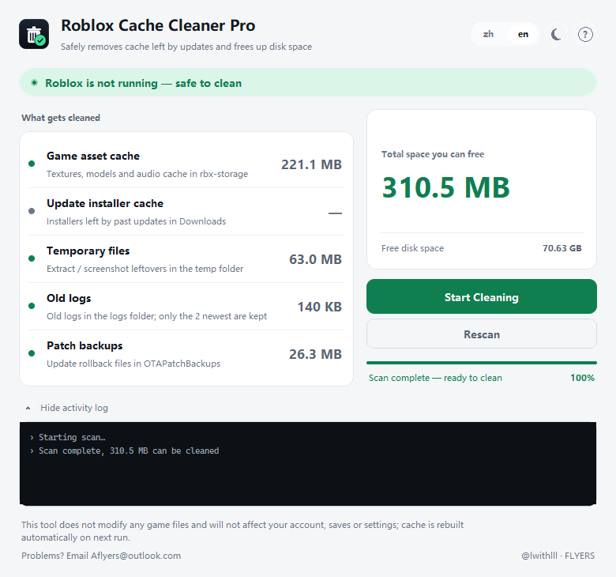

# Roblox Cache Cleaner Pro

Roblox cache leftovers cleaner.

Windows 10 / 11, 64-bit

**English** · [中文](#中文)

---

## Download

**[Get the latest release](https://github.com/Lwithlll/roblox-cache-cleaner/releases/latest)**

Unzip it anywhere and run `Roblox Cache Cleaner Pro.exe`.

[VirusTotal](https://www.virustotal.com/gui/file/ca6057cfaf73988610ac4bfa0c13179030ec64fb7bdf0d8a08acc0684fa5d4c7): 66 of 67 engines find nothing. The one that does is Bkav, and it's wrong.

SHA-256: `ca6057cfaf73988610ac4bfa0c13179030ec64fb7bdf0d8a08acc0684fa5d4c7`



## What it does

**1. Checks whether Roblox is running.** If it is, close the game first — cleaning while it runs can cause problems.

**2. Deletes the contents of five folders**, all under `%LOCALAPPDATA%\Roblox\`:

```
rbx-storage/    logs/    Downloads/    OTAPatchBackups/    tmp-capture-storage/
```

The folders stay. Only their contents go.

Any of the five can be unticked before cleaning.

## Safety

The complete import list of the core module:

```python
import ctypes, os, re, shutil
from ctypes import wintypes
```

No `socket`, `requests`, `subprocess`, `winreg`.

Doesn't touch game files, saves, settings or account data.

## Antivirus

The exe isn't code-signed, and it's a single file that unpacks itself at launch. Both of those trip heuristic scanners, so Defender, Huorong or 360 may flag it.

That's a packaging problem, not a behaviour problem. Here's the VirusTotal report: [66 clean, 1 wrong](https://www.virustotal.com/gui/file/ca6057cfaf73988610ac4bfa0c13179030ec64fb7bdf0d8a08acc0684fa5d4c7).

The one flag is Bkav, a Vietnamese engine known for this. Its signature is `W32.Malware.3E69FC40`, generic, not a behaviour it observed.

To allow it anyway:

- **Windows Defender** → Virus & threat protection → Manage settings → Exclusions → Add an exclusion → File
- **Huorong** → tray icon → Trust Zone → Add file
- **360 / PC Manager** → click "Add to trust" in the popup, or restore it from quarantine

## Questions

**Will I get banned?**
No. Only local files are removed. Nothing is uploaded, and the game rebuilds the cache on its next launch.

**Do I need to close the game first?**
Yes, otherwise you may run into problems in-game.

## Disclaimer

Not affiliated with, endorsed by, or supported by Roblox Corporation. "Roblox" is a trademark of Roblox Corporation.

Something broken? Aflyres@outlook.com

---

## 中文

# Roblox Cache Cleaner Pro

Windows 10 / 11，64 位

## 下载

**[下载最新版本](https://github.com/Lwithlll/roblox-cache-cleaner/releases/latest)**

解压到任意位置，双击 `Roblox Cache Cleaner Pro.exe`。

[VirusTotal 报告](https://www.virustotal.com/gui/file/ca6057cfaf73988610ac4bfa0c13179030ec64fb7bdf0d8a08acc0684fa5d4c7)：67 家引擎里 66 家无报错

SHA-256：`ca6057cfaf73988610ac4bfa0c13179030ec64fb7bdf0d8a08acc0684fa5d4c7`


## 使用大预

**一、检测 Roblox 在不在运行。** 如正在运行，请退出 Roblox 再使用，避免问题

**二、确认清理后删掉五个目录里的东西**，都在 `%LOCALAPPDATA%\Roblox\` 下面：

```
rbx-storage/    logs/    Downloads/    OTAPatchBackups/    tmp-capture-storage/
```

目录保留，仅清理这五个缓存文件夹的内容

清理前可以取消勾选任意几项

## 安全性

核心模块的全部 import

```python
import ctypes, os, re, shutil
from ctypes import wintypes
```

不含 `socket`，`requests`，`subprocess`，`winreg`。

不修改游戏本体文件、存档、设置、账号数据

## 杀毒软件

exe 没做代码签名，而且是单文件自解压，启动时会释放出东西来。这两点都容易让杀软弹窗，Defender、火绒、360 都可能。

这是打包方式的问题，不是行为的问题。这是 VirusTotal 的检测 [66 家干净、1 家误报](https://www.virustotal.com/gui/file/ca6057cfaf73988610ac4bfa0c13179030ec64fb7bdf0d8a08acc0684fa5d4c7)。

报的那家是 Bkav，越南引擎，这类误报挺出名，签名 `W32.Malware.3E69FC40` 是通用的。

还是想加白的话：

- **Windows Defender** → 病毒和威胁防护 → 管理设置 → 排除项 → 添加或删除排除项 → 文件
- **火绒** → 托盘图标 → 信任区 → 添加文件
- **360 / 电脑管家** → 弹窗点「添加信任」，或从隔离区恢复

## 常见问题

**会被封号吗？**
不会。删的是本地文件，不上传任何东西，游戏下次启动自己重建。

**要先关游戏吗？**
需要先关闭游戏，否则可能会出现游戏内问题

## 免责声明

本项目与 Roblox Corporation 无任何关联，未获其认可或支持。「Roblox」是 Roblox Corporation 的商标。

出问题了？Aflyres@outlook.com

---

Copyright © 2026. All rights reserved.
Binary redistribution is permitted. Re-uploading this build as your own work is not.
